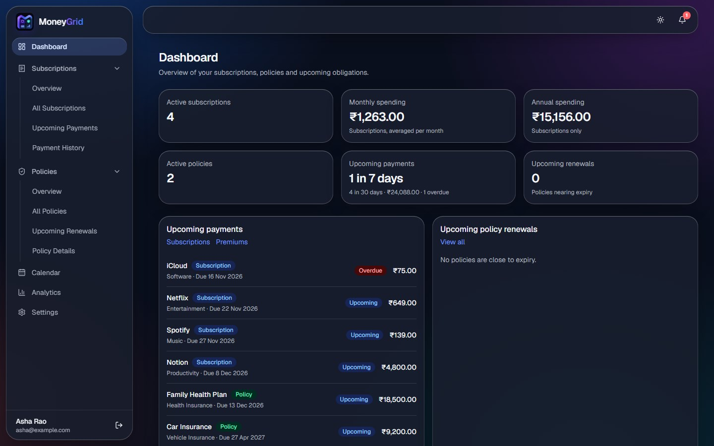
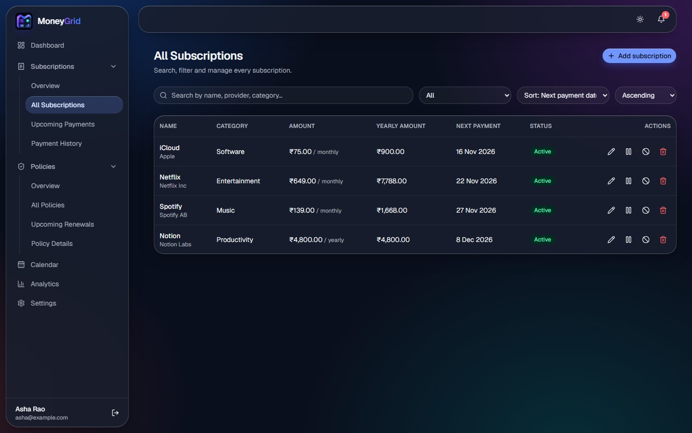
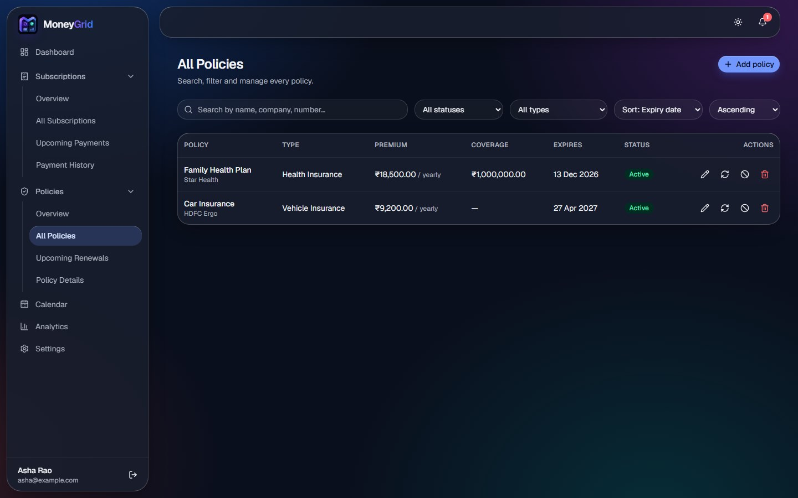
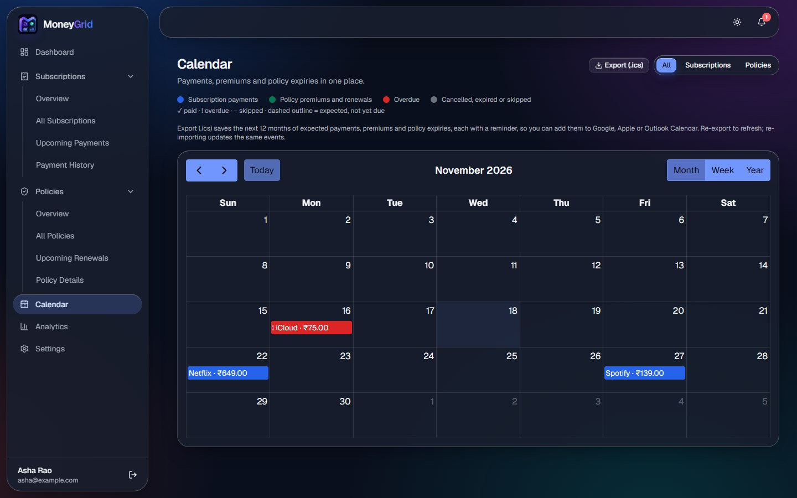
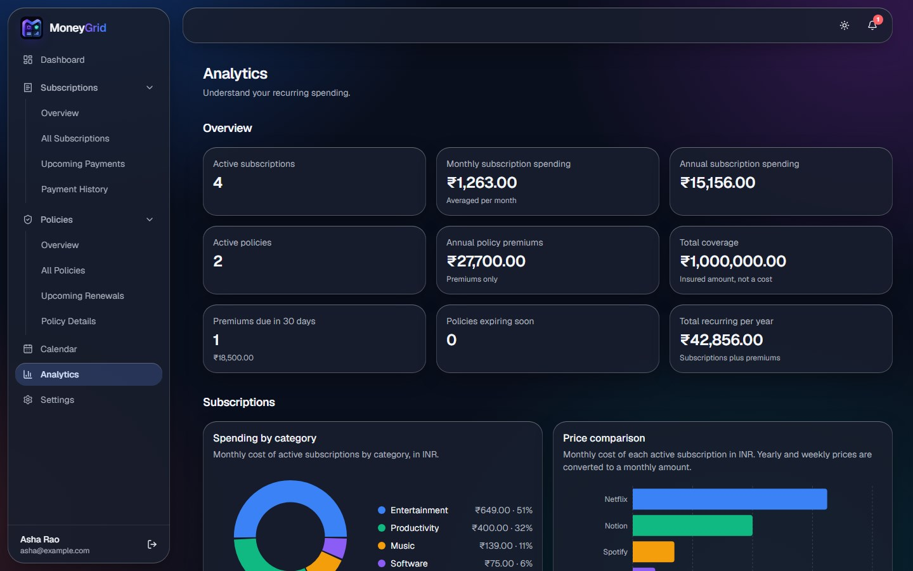
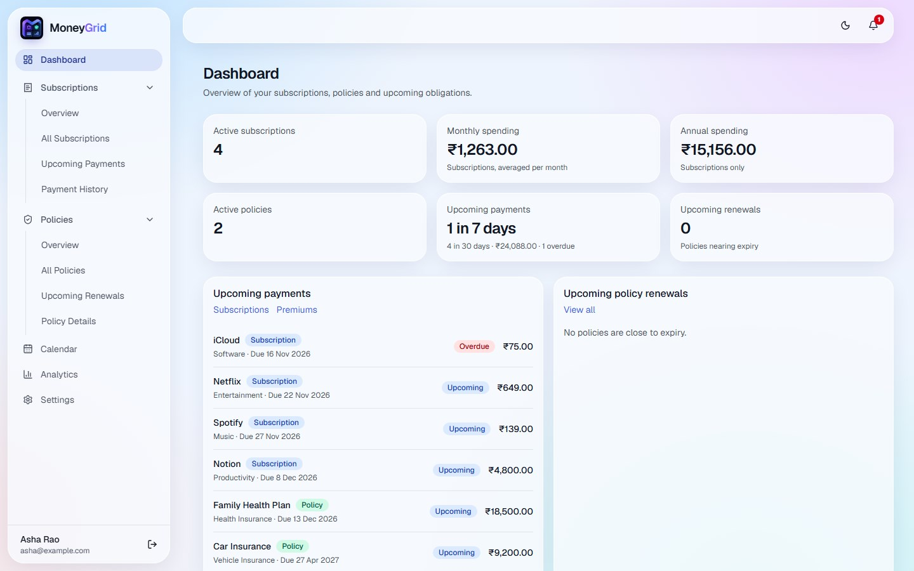
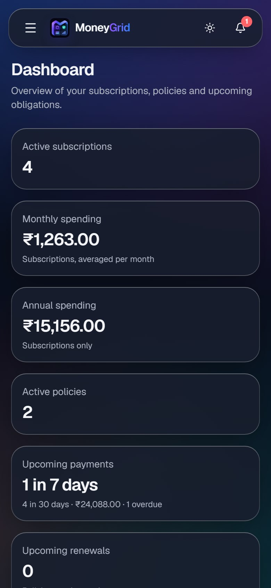

<div align="center">


# MoneyGrid

**Every subscription, every policy, every due date — in one place.**

Track recurring subscriptions and insurance policies, know exactly what is due and when, and see where your money goes.

[**Live demo → moneygrid-xi.vercel.app**](https://moneygrid-xi.vercel.app)


<br />



</div>

---

## Overview

MoneyGrid is a personal finance tracker for the money that leaves your account on a schedule: streaming and
software subscriptions on one side, insurance policies and premiums on the other. It keeps the two
separate where they differ (a policy has an expiry and a renewal; a subscription just keeps going) and brings
them together where it helps: one dashboard, one calendar, one set of reminders.

Sign in with email and password or Google, add what you pay for, and MoneyGrid works out the next payment date,
flags what is overdue, and shows what you spend per month and per year.

## Screenshots

<table>
  <tr>
    <td width="50%"><br /><sub><b>Subscriptions</b> — search, filter, sort, with yearly cost per row</sub></td>
    <td width="50%"><br /><sub><b>Policies</b> — premiums, coverage and expiry at a glance</sub></td>
  </tr>
  <tr>
    <td width="50%"><br /><sub><b>Calendar</b> — payments, premiums and expiries, exportable to your own calendar</sub></td>
    <td width="50%"><br /><sub><b>Analytics</b> — spending by category and price comparison</sub></td>
  </tr>
  <tr>
    <td width="50%"><br /><sub><b>Light mode</b> — dark is the default; light and "match my device" are one click away</sub></td>
    <td width="50%" align="center"><br /><sub><b>Responsive</b> — the same app on a phone</sub></td>
  </tr>
</table>

## Features

**Subscriptions**
- Add, edit, pause, resume, cancel and delete. Cancelling keeps the payment history; deleting removes it.
- Weekly, monthly, quarterly, half-yearly and yearly billing. The next payment date is worked out for you from the start date and cycle (and you can override it).
- Payment history with *mark as paid* and *skip*; an overdue payment is flagged automatically.
- Search, filter by status, sort and paginate. Every row shows the amount and the equivalent **yearly amount**.

**Policies**
- Health, vehicle, life, home, travel and other policies, with provider, policy number, premium, coverage (optional), and expiry date.
- Premium due dates follow the billing cycle and stop at the expiry date. "Expiring soon" and "expired" are worked out automatically.
- Renewal flow that records each term in a renewal history.

**Dashboard, analytics and calendar**
- Summary cards (active items, monthly and annual spend, what is due in the next 7 and 30 days), upcoming payments and renewals, and recent activity.
- Charts: monthly expenditure, spending by category, price comparison, historical trend and policy premiums.
- Month, week and year calendar views with a Subscriptions / Policies filter, plus **`.ics` export** with reminders so everything also lives in Google, Apple or Outlook Calendar.

**Reminders**
- In-app notifications for upcoming payments, premiums, policies about to expire, overdue payments and confirmations, with per-record reminder times and a settings page. Each reminder is created exactly once and closes itself when it no longer applies.

**Experience**
- A *liquid glass* interface with a dark default, a light theme and "match my device", remembered per browser.
- Collapsible sidebar groups, a responsive layout from phone to desktop, keyboard-friendly and screen-reader-friendly controls.
- Multi-currency: totals are always shown per currency and are never mixed or converted.

## Tech stack

| Area | Choice |
|---|---|
| UI | React 19, TypeScript, Vite 8 |
| Styling | Tailwind CSS 4, shadcn/ui on Base UI primitives, lucide icons, sonner toasts |
| Routing and state | React Router 7 (lazy routes, route guards), Zustand |
| Forms | React Hook Form with Zod schemas |
| Charts and calendar | Recharts, FullCalendar |
| Dates | date-fns |
| Backend | Firebase Authentication and Cloud Firestore, with owner-only security rules |
| Hosting | Vercel |
| Tests | Vitest and jsdom, `@firebase/rules-unit-testing` with the Firebase emulators |

## Getting started

**Prerequisites:** a current Node.js LTS release and npm.

```bash
git clone https://github.com/adi-samson7/moneygrid.git
cd moneygrid
npm install
npm run dev          # http://localhost:5173
```

By default the app runs entirely in the browser: sign-in is a **mock** and data is kept in `localStorage`. Nothing
else is needed, which makes it the quickest way to try it. Register any email and a password of 8+ characters.

### Run against Firebase

1. Copy `.env.example` to `.env.local` and fill in the values from your Firebase web app
   (Project settings → General → Your apps).
2. Run `npm run dev`.

| Variable | Purpose |
|---|---|
| `VITE_BACKEND` | `firebase` to use Firebase; leave unset for local mode |
| `VITE_FIREBASE_API_KEY` | Firebase web app API key |
| `VITE_FIREBASE_AUTH_DOMAIN` | Sign-in domain (`<project>.firebaseapp.com`, or your own site's address) |
| `VITE_FIREBASE_PROJECT_ID` | Firebase project ID |
| `VITE_FIREBASE_APP_ID` | Firebase web app ID |
| `VITE_USE_EMULATORS` | `true` to use the local emulators instead of a real project |

`.env.local` is git-ignored. These values identify your project but are not secrets; the security rules protect the
data. A step-by-step guide to creating the project, enabling sign-in, deploying the rules and going live is in
[docs/FIREBASE_SETUP.md](docs/FIREBASE_SETUP.md).

To try Firebase mode with no account at all, use the emulators: `npm run emulators` in one terminal and
`npm run dev:emulator` in another.

## Scripts

| Command | What it does |
|---|---|
| `npm run dev` | Start the dev server |
| `npm run build` | Type-check and create a production build |
| `npm run preview` | Serve the production build locally |
| `npm test` | Run the whole test suite once |
| `npm run test:watch` | Run tests in watch mode |
| `npm run test:emulator` | Run the security-rules and Firebase tests against the emulators |
| `npm run lint` | Lint with oxlint |
| `npm run emulators` / `npm run dev:emulator` | Start the Firebase emulators / run the app against them |
| `npm run deploy:rules` | Deploy the Firestore security rules and indexes |

## How the data works

- **Dates** are `YYYY-MM-DD` strings (calendar dates, no time zone). **Money** is stored as integer minor units
  (paise or cents) so there is no rounding drift.
- **Payments are never assumed.** Each active subscription or policy has one open payment. It stays open until you
  mark it paid or skipped; only then does the next cycle open. *Overdue* is derived from an open payment whose date
  has passed.
- **Billing dates** are anchored to the start date and clamped to the length of the month, so a subscription that
  starts on 31 Jan pays on 28/29 Feb and 31 Mar, and a yearly plan that starts on 29 Feb copes with leap years.
- **Statuses are derived**, not stored: overdue, expiring soon and expired are worked out from the dates every time.
- **Per user.** Everything lives under `users/{uid}/…`, so accounts never see each other's records.

### Data layer

All data access goes through one small interface (`src/services/db/`) with two implementations, `localStorage` and
Firestore, and the services are written once on top of it. Writes that belong together (a subscription, its open
payment and an activity entry) are committed in one batch, and recording a payment re-checks at write time that it
is still open, so a double click or a second tab cannot record it twice.

## Security

Firestore security rules (`firestore.rules`) apply the principle of least privilege:

- Each signed-in user can reach **only their own** documents.
- Every document is validated: exact fields, types, allowed values and sizes.
- Ownership fields and creation times cannot be changed; paid and skipped payments cannot be rewritten; the activity
  log is append-only; everything not listed is denied.
- A test fails if the rules' allowed values drift from the app's types.

Passwords are handled entirely by Firebase Authentication; the app never sees or stores them. The mock sign-in used in
local mode keeps a salted hash in the browser and is for development only.

## Testing

`npm test` runs the whole suite (Vitest and jsdom):

- **Logic tests** for billing dates (checked against an independent calculation for every start day of a leap and a
  non-leap year, every billing cycle, and several time zones including daylight-saving ones), payments, policies,
  statistics, calendar events, notifications and the `.ics` export.
- **Browser-flow tests** that boot the real app and use it like a person would: sign up, add and edit records, mark
  payments, change settings, switch theme, export the calendar. They also check accessibility basics on every page and
  form, and error handling (404, a crashed page, a failed save, damaged stored data).
- **Emulator tests** (`npm run test:emulator`) check the security rules, that the Firestore data layer behaves exactly
  like the `localStorage` one, and that the app works end to end on Firebase.

The test setup refuses to talk to a real Firebase project, so a test run can never touch live data.

## Deployment

The site is deployed from `master` to Vercel, and every push redeploys it.

- [`vercel.json`](vercel.json) sends all paths to `index.html` (so refreshing any page works), sets security headers,
  and proxies `/__/auth/*` to Firebase so Google sign-in runs on the site's own address.
- Set `VITE_BACKEND=firebase` and the four `VITE_FIREBASE_*` variables in Vercel → Settings → Environment Variables,
  then redeploy.
- In Firebase, add the site's address under Authentication → Settings → Authorized domains. For Google sign-in on that
  address, list `https://<address>` as an authorized origin and `https://<address>/__/auth/handler` as a redirect URI
  on the Google Cloud OAuth client.

## Project structure

```
src/
  components/   ui/ (shadcn), common/, layout/, dashboard/, subscriptions/, policies/, calendar/, settings/
  pages/        one folder per area
  services/     all data access; db/ holds the localStorage and Firestore implementations; mock/ the mock sign-in
  stores/       Zustand stores (auth, subscriptions, policies, notifications)
  hooks/        data-loading hooks used by pages
  schemas/      Zod form validation
  types/        record types
  utils/        pure logic: billing, dates, money, status rules, stats, calendar events, .ics
  routes/       router, route guards, sidebar navigation
  lib/          small helpers (class names, theme)
  __tests__/    the test suite; test/ has the helpers (app harness, step runner, jsdom setup)
docs/           Firebase setup guide and screenshots
firestore.rules security rules
```

## Known limitations

- **No emailed or pushed reminders.** Reminders appear when the app is open, because sending them needs a server.
  The `.ics` export is the workaround: import it and your calendar app does the reminding.
- **No currency conversion.** Totals are shown per currency.
- The theme and sidebar choices are stored per browser, not per account.
